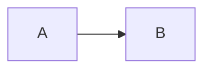
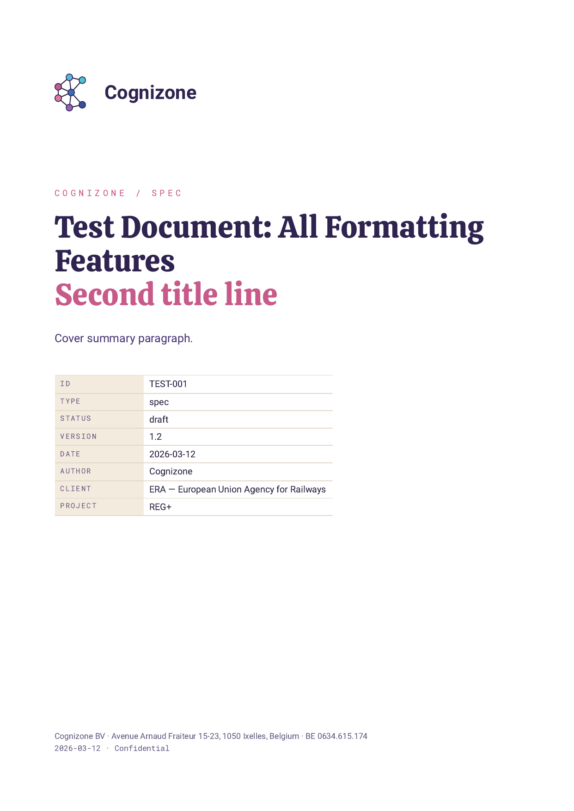
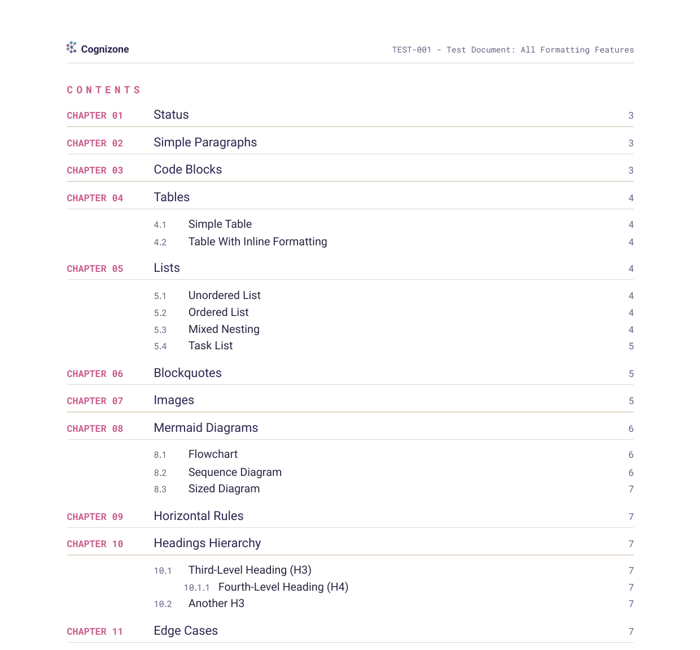
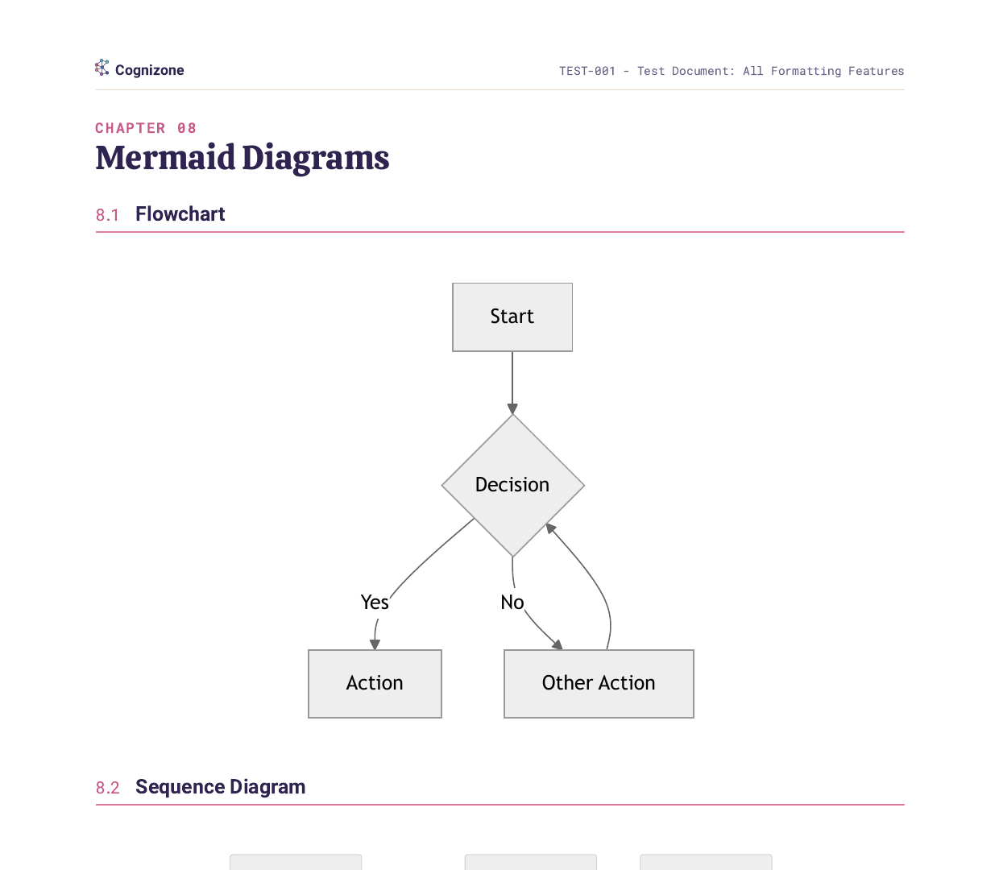
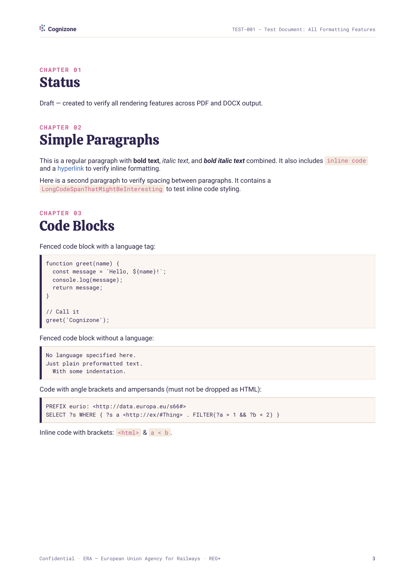

# @cognizone/brand-docs

Cognizone branded document conversion. Converts Markdown files to PDF, Word (.docx), or HTML using Cognizone brand styles (colors, fonts, layout).

Works on macOS, Linux, and Windows — no bash or pandoc required. One step is macOS-only: filling in the page numbers of a Word file's contents page (see [Page numbers in a Word file's contents page](#page-numbers-in-a-word-files-contents-page)).

## Features

- **PDF, Word, and HTML output** from a single Markdown source
- **Self-contained HTML** — a single `.html` file with fonts, images, logo, and mermaid embedded; opens offline in any browser
- **Folder merge** — pass a folder to combine all Markdown files (`.md`, `.markdown`) into a single PDF or HTML file with a master cover page and TOC
- **Branded cover page** with document ID, title, and metadata table
- **Auto-generated table of contents** with section numbers and page references (in Word files the page numbers need Word: automatic on macOS, a manual step elsewhere)
- **Branded headers and footers** with logo, document title, client/project info, and page numbers
- **Mermaid diagrams** — `\`\`\`mermaid` code blocks render as visual diagrams (flowcharts, sequence diagrams, etc.)
- **Full Markdown support** — headings, tables, lists (nested/mixed), code blocks, blockquotes, images, links, inline formatting
- **HTML `` tags** with width/height for precise image sizing (give only one and the other follows the image's aspect ratio)
- **YAML frontmatter** for document metadata (title, subtitle, summary, id, type, status, version, date, author, client, project, classification)
- **Cognizone 2026 brand** — plum / cream colours, Calistoga titles, Roboto / Roboto Mono text, A4 layout
- **Cross-platform** — pure Node.js, no bash or pandoc dependency

## Requirements

- [Node.js](https://nodejs.org/) ≥ 18 with npm (check with `node -v` and `npm -v`)
- Access to the `cognizone/cognizone-brand-docs` GitHub repository (the package installs from it)

Works the same on macOS, Windows and Linux, except that Word contents page numbers are filled in automatically only on macOS with Microsoft Word.

## Installation

```bash
npm install -g cognizone/cognizone-brand-docs
cognizone-convert --version
```

To update to the latest version, run the same install command again.

PDF and Word output render through a headless Chrome. Recent npm versions skip install scripts by default (you may see `npm warn install-scripts ... puppeteer`), so Chrome is downloaded automatically the first time you convert a document (about 150 MB, once, into `~/.cache/puppeteer`; on Windows `%USERPROFILE%\.cache\puppeteer`). HTML output needs no browser.

### Fonts for Word output

Word documents reference fonts by name, so install [Calistoga](https://fonts.google.com/specimen/Calistoga), [Roboto](https://fonts.google.com/specimen/Roboto) and [Roboto Mono](https://fonts.google.com/specimen/Roboto+Mono) on the machine that opens the `.docx` (PDF and HTML embed their fonts):

- **macOS** — double-click each `.ttf` and click *Install* (Font Book)
- **Windows** — right-click each `.ttf` → *Install for all users*
- **Linux** — copy the `.ttf` files to `~/.local/share/fonts/` and run `fc-cache -f`

### Troubleshooting

| Problem | Fix |
|---|---|
| `command not found: cognizone-convert` | npm's global bin folder is not on your `PATH`. It is `$(npm prefix -g)/bin` on macOS/Linux and the `npm prefix -g` folder itself on Windows. Open a new terminal after changing `PATH`. |
| `EACCES` / permission error on install (macOS/Linux) | Don't use `sudo`; install Node with a version manager ([Volta](https://volta.sh), [nvm](https://github.com/nvm-sh/nvm)) so global installs go to your home folder. |
| 404 or authentication error on install | Check that your GitHub account has access to the Cognizone organisation. |
| `Could not find Chrome` | Run `npx puppeteer browsers install chrome`. On a minimal Linux install Chrome may also need system libraries; see the [Puppeteer troubleshooting guide](https://pptr.dev/troubleshooting). |
| Word contents page shows `–` or wrong page numbers | The conversion printed `ACTION NEEDED`: Word could not fill them in. Choose **References → Update Table → Update page numbers only** in Word, or on macOS with Microsoft Word run `cognizone-docx-toc file.docx`. "Update entire table" replaces the 2026 styling with Word's default look. |

## Usage

```bash
cognizone-convert document.md                        # converts to PDF (default)
cognizone-convert document.md --format docx          # converts to Word
cognizone-convert document.md --format html          # converts to self-contained HTML
cognizone-convert document.md -f docx                # short form
cognizone-convert document.md output/custom-name.pdf # custom output path

# Folder merge (PDF or HTML)
cognizone-convert docs/                              # merges all .md/.markdown files → docs.pdf
cognizone-convert docs/ -f html                      # merges all .md/.markdown files → docs.html
cognizone-convert docs/ merged-output.pdf            # custom output path
```

Without `-f`, an output path ending in `.pdf`, `.docx` or `.html` picks the format (`document.md out.docx` writes Word). Without an output path, a single file is written next to the input with its extension replaced (`NOTES.MD` → `NOTES.pdf`). The tool refuses to write over its own input.

An unknown option, an option without its value, or a third file argument is an error.

A folder merge takes every `.md` and `.markdown` file (any case) in the folder and its subfolders, in alphabetical order.

All output uses the 2026 Cognizone brand; no flag is needed.

Word output embeds PNG, JPEG, GIF and BMP images and converts SVG images to PNG. Any other file used as an image is left out with a warning and shows as `[alt text]`.

Raw HTML in the Markdown can't run anything in HTML or PDF output: `<script>`, `on…=` handlers and `javascript:` links are inert, and `<iframe>` / `<object>` load nothing.

### Page numbers in a Word file's contents page

A new Word file has `–` where the contents page numbers go: only Word can work them out. **Check the last lines of every Word conversion.** It ends in one of two ways:

| The conversion ends with | What it means | What you do |
|---|---|---|
| `Contents page numbers filled in.` | Word opened the file and filled in the numbers. | Nothing. |
| `ACTION NEEDED: the contents page of … has no page numbers yet` | The numbers are still `–`. | Open the file in Word and choose **References → Update Table → Update page numbers only**. |

Which one you get depends on the machine:

| Where you run it | Result |
|---|---|
| macOS with Microsoft Word | Filled in automatically. |
| macOS without Word, Windows, Linux | Always `ACTION NEEDED`: you do the step in Word yourself. |
| `COGNIZONE_NO_WORD=1` set (scripts, unattended runs) | Always `ACTION NEEDED`; Word is not opened. |

The conversion succeeds (exit code 0) in both cases, so a script cannot tell them apart: read the output.

On macOS the automatic step can still end in `ACTION NEEDED`:

- **"Grant File Access" dialog.** The first time Word is asked to open a file in a folder, it shows this dialog. Choose **Select…** and grant access to the folder; later files there go through without asking. If you cancel it, or don't answer within two minutes, the numbers are not filled in.
- **The file is already open in Word.** Close it and convert again.
- **Automation permission.** Your terminal app must be allowed to control Microsoft Word (System Settings → Privacy & Security → Automation).

`cognizone-docx-toc file.docx` runs the automatic step on its own for a file made earlier (macOS with Word only).

Don't pick "Update entire table" in Word: it replaces the 2026 styling with Word's default look.

### Using it from Claude Code

Claude Code picks the tool up from the shell like any other command. To make it the default for client-facing documents, add a short section to your `~/.claude/CLAUDE.md`:

```markdown
## Cognizone branded documents
Render client-facing Markdown deliverables with `cognizone-convert` (`-f pdf|docx|html`),
never with plain pandoc. It uses the 2026 Cognizone brand.
After a docx conversion, read the last lines of the output: if they say `ACTION NEEDED`,
the contents page has no page numbers yet; tell the user to fill them in in Word
(References → Update Table → "Update page numbers only").
```

## Document format

Input files should be Markdown with YAML frontmatter:

```yaml
---
title: "My Document Title"
id: ADR-001
type: adr
status: draft
date: 2025-01-01
author: Cognizone
client: "ERA — European Union Agency for Railways"
project: REG+
---
```

The frontmatter must be YAML; `---js` / `---javascript` frontmatter is refused. All fields are optional. Supported frontmatter fields: `title`, `id`, `type`, `status`, `version`, `date`, `author`, `client`, `project`, plus `subtitle`, `summary` and `classification` (see [Cover and footer fields](#cover-and-footer-fields)).

### Cover and footer fields

Extra optional frontmatter fields used by the cover and footer:

| Field | Use |
|---|---|
| `subtitle` | Second title line, in pink |
| `summary` | Paragraph under the title. Keep it short: a PDF cover that doesn't fit on one page is cut off (the tool warns) |
| `classification` | e.g. `Confidential`, shown on the cover and in the footer |

The style spec is [`reference/brand-2026-spec.md`](reference/brand-2026-spec.md); the logo pack is in [`assets/brand-2026/`](assets/brand-2026/).

## Links in delivered documents

Markdown in a repo links to GitHub, to other docs by relative path, and to headings in the same doc. A Word or PDF file handed to a client can't follow most of those, so three options control what happens to links. By default every link is kept as written, except `javascript:`, `vbscript:` and `data:` links, which always become plain text.

| Option | Effect |
|---|---|
| `--no-external-links` | Links to sites and other files become plain text (the text and its formatting stay), raw HTML `<a href>` links too. `#heading` links in the same document still work. |
| `--relative-links` | A relative link to another `.md` points at that doc's converted file: `../EVR-10/case-model.md#states` → `../EVR-10/case-model.docx`. |
| `--link-base <url>` | As `--relative-links`, but the link is a full web address: `<url>` + the target's path from the folder you run the command from. |

`--no-external-links` and `--link-base` work for PDF, Word and HTML; `--relative-links` is for Word and HTML (a PDF gets absolute paths on the machine that made it). `--relative-links` and `--link-base` apply to single files only (a folder merge is one file), and they drop the `#section`: the link opens the other doc at its start. In a folder merge, `#heading` links still go to the heading in their own document.

### Word files on SharePoint

Word for the web can't follow relative links (it opens `https://../EVR-10/case-model.docx`), so use `--link-base` for a SharePoint delivery:

1. Link docs to each other with **relative paths** in the Markdown, not GitHub URLs. GitHub URLs are not rewritten; with `--no-external-links` they become plain text.
2. Upload the Word files with the **same folder layout** as the repo.
3. Run each conversion from the folder that maps to the SharePoint folder, passing that SharePoint folder's address:

```bash
cognizone-convert specs/EVR-13/EVR-13-search.md -f docx --no-external-links \
  --link-base "https://<tenant>.sharepoint.com/sites/<site>/<library>/Forms/AllItems.aspx?id=..."
```

- Paste the address straight from the browser's address bar while viewing the folder; the `AllItems.aspx?id=…` form is understood (its `id` must be a folder path starting with `/` on the same site). The address must start with `http://` or `https://`. A short "Copy link" sharing address (`/:f:/s/…`) has no folder path in it and does not work.
- SharePoint links get `?web=1`, so the file opens in Word for the web instead of downloading.
- A link to a doc outside the folder you run from can't be made absolute: with `--no-external-links` it becomes plain text, otherwise it stays relative (with a warning).
- A link to a doc you don't upload is broken, and moving or renaming the SharePoint folder means rebuilding with the new address.

`--relative-links` only suits HTML, or Word files opened from a OneDrive-synced folder; in a PDF, Chrome turns relative links into absolute paths on the machine that made it.

## Sizing mermaid diagrams

Add options to the fence line to control per-diagram width and alignment. Applies to PDF, DOCX, and HTML output.

````markdown

````

| Option | Values | Default | Effect |
|---|---|---|---|
| `maxWidth` | integer pixels | `500` | Upper bound on rendered width; height scales proportionally |
| `align` | `left`, `center`, `right` | `center` | Paragraph alignment of the diagram |

Unknown or invalid values are ignored with a warning on stderr; the diagram still renders with defaults.

## Output preview

Sample outputs generated from the [test fixture](test/fixture.md): [PDF](test/output/brand-2026.pdf) | [Word](test/output/brand-2026.docx)

PDF output in the 2026 Cognizone brand:

### Cover page



### Footer


### Table of contents



### Mermaid diagrams



### Body content


